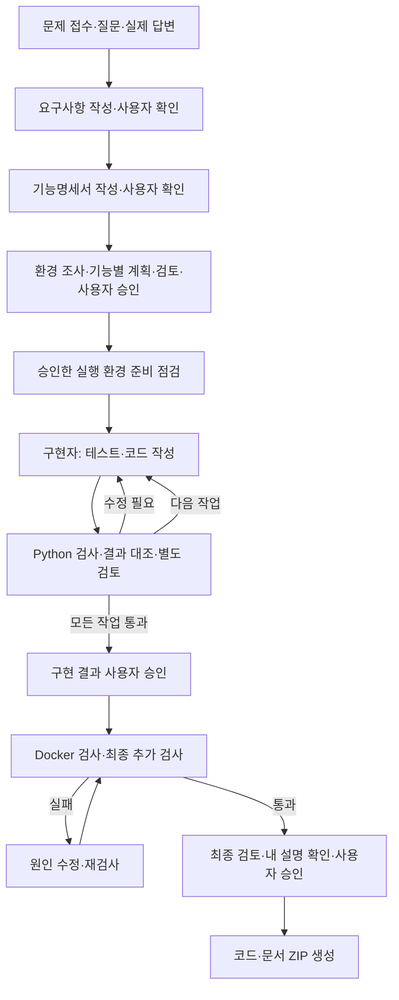

# Python 3.9 승인형 하네스 + Codespaces 웹·DB 예제

기존 하네스에 **SvelteKit + FastAPI + PostgreSQL** 실행 예제와 Docker Compose·Codespaces 설정을 추가했습니다. Sol 6.1 / 독립 검토 Terra 5.6, 단계별 승인, 중단 복구, 새 과제 160분 제한은 유지합니다.

- `.devcontainer/`: Python 3.9·Node 24·Codex CLI·Docker 개발 환경
- `starters/web-postgres/`: 실제 Dockerfile, Compose, DB 영속 볼륨, 메모 저장·조회 예제
- `.agents/skills/postgres/`, `.agents/skills/docker-containers/`: 기존 승인 흐름에 맞춘 지침
- `problem-project/INTERVIEW.md`: 사용자가 선택한 웹 구성을 실제 답변으로 기록

Codespaces에서는 ZIP **안의 폴더 내용**을 GitHub 저장소 루트에 올린 뒤 Codespace를 만드세요. 준비된 터미널에서:

```bash
cd starters/web-postgres
python setup.py
docker compose up --build -d --wait
```

Ports 탭의 **3000**을 열면 예제 화면을 볼 수 있습니다. 실행·재시작 보존 검사·백업·실제 과제 적용 방법은 **[웹·DB 실행 안내](starters/web-postgres/README.md)**에 있습니다. 예제 준비는 과제 타이머를 시작하지 않습니다. 실제 문제를 받으면 저장소 루트에서 아래의 `python run_harness.py start`부터 진행하세요. Codex 로그인은 Codespace에서 별도로 필요합니다.

이번 환경에서 수행한 검사는 [검증 기록](validation/CODESPACES_VALIDATION.md)에 있습니다. 실제 Docker 엔진에서의 빌드·DB 영속성·Codespaces 최초 생성은 아직 검증하지 못했습니다.

**이 배포판은 Python 3.9.x에서 실행하도록 안내하는 한 벌의 코드입니다.** 이전에 표시한 3.9·3.13은 같은 코드를 검사한 두 환경이며 서로 다른 실행 프로그램이 아닙니다. `validation/`의 3.13 기록은 추가 호환성 검사 이력입니다.

Codespaces에서는 개발 컨테이너가 Python 3.9를 준비합니다. 아래 명령의 `python --version` 결과가 `Python 3.9.x`인지 확인하세요. Windows에서 직접 실행할 때는 Python 3.9를 설치하고 `python` 대신 `py -3.9` 또는 해당 가상환경의 실행 파일을 사용하세요. 인터프리터 자체는 ZIP에 포함하지 않습니다.

PyCharm에서는 프로젝트 인터프리터를 Python 3.9로 선택하세요. 개인별 3.13 인터프리터를 가리킬 수 있는 `.idea/` 설정은 배포하지 않습니다. 폴더 이름만 바꿔서는 IDE의 인터프리터가 바뀌지 않습니다.

문제 설명과 실제 담당자 답변으로 요구사항·기능명세서를 확인한 뒤, 구현 계획·코드·테스트·검토·로컬 Docker 검증까지 진행합니다. 기존 인터뷰, CSV 이상값 후보 검사, 문서 확인과 중단 복구 기능을 유지합니다. **새 과제의 기본 제한은 160분(9600초)**이며, 이미 150분(9000초)으로 시작한 과제는 저장된 접수 시각과 마감을 유지합니다.

**`requirements`는 기존처럼 기능명세서 확인까지만 진행합니다.** 새 명령 **`run`**은 문서 단계를 마치면 개발 단계로 연결하고, **`develop`**은 확인된 기능명세서 다음부터 진행하거나 재개합니다. 각 승인 지점에서 실행을 멈춥니다.

기반 버전에 포함된 다섯 가지 수정도 유지합니다.

| 수정 | 동작 |
|---|---|
| 시간 제한 | 새 과제는 160분, 기존 진행 과제는 저장된 마감 보존 |
| 데이터 실패 전달 | 실패 원인과 입력·산출물 단계를 구현자에게 전달 |
| 중복 검사 계획 | 새 계획의 중복 실행 명령 거부, 기존 승인 계획과 필수 검사 유지 |
| 준비 점검 | PLAN 승인 후 첫 테스트 작성 전에 확인, 미준비면 같은 단계에서 재개 |
| 과설계 검토 | 선택 이유·더 단순한 대안·추가 비용 대비 효과 검토, 불필요한 대안 목록은 요구하지 않음 |



## 유지되는 추가 검사

새 계획은 `plan.assurance`에 과제 유형과 검사 기준을 기록합니다. **계획 승인에 함께 포함하며 새 GATE 종류를 추가하지 않습니다.** 해당하지 않는 검사는 제외 이유를 명시합니다.

| 검사 | 실행 시점 | 확인하는 것 |
|---|---|---|
| 실행 환경 조사·준비 점검 | 계획 전 조사·계획 검토 전 확인, PLAN 승인 후 첫 테스트 작성 직전 준비 점검 | Python·설치 패키지·필요 실행기·지정 포트. 미준비면 `BLOCKED`로 멈추고 같은 단계에서 재개 |
| 입력 파일 연결 검사 | 계획 검토 전 | 연결 키·빈 키·중복·미연결·행 수 증가가 명시한 연결 관계와 일치하는지 |
| 입력 처리대장 대조 | 담당 작업의 테스트 후와 최종 검사 | 입력 ID가 사용·제외·보류 대장에 누락·중복·추가 없이 분류됐는지 |
| 알고리즘 후보 비교 | 담당 작업의 테스트 후와 최종 검사 | 같은 입력의 최대 3개 후보를 필수 제약부터 검사하고, 승인한 기준안·오차·퇴보 한계와 비교 |
| 실제 브라우저 검사 | Docker 통과 후, 최종 검토 전 | 웹 과제만 승인된 화면 크기·조작·DOM 기대값과 넘침·오류를 검사하고 PNG·보고서 보존 |

처리대장·알고리즘 측정 스크립트도 구현자가 작성합니다. 측정 명령은 회당 **최대 300초**, 모든 추가 검사는 과제의 저장된 마감 안에서 실행합니다(새 과제 기본 160분). 입력 원본과 제어 기록은 변경하지 않으며 검사 산출물은 지정된 임시 증거 폴더에 저장합니다.

웹 과제의 브라우저 검사에는 사용 중인 Python 버전을 지원하는 Playwright와 선택한 브라우저가 미리 준비되어 있어야 합니다. 환경 조사·브라우저 검사 도구는 **자동 설치하지 않습니다**. 준비되지 않으면 `BLOCKED`이며 필수 검사를 건너뛰고 완료하지 않습니다. 비웹 과제에서는 브라우저를 찾거나 실행하지 않습니다.

이미 저장·승인된 이전 계획에 추가 검사 계약이 없으면 기존 흐름을 유지하고 **추가 검사 미설정**으로 표시합니다. 새 계획에는 적용·제외 이유가 필요합니다. 기존 과제에 새 계약을 넣으려면 승인받는 방향 전환으로 재계획하세요. `--refresh-inputs`는 실제로 재확인된 요구사항·기능명세서 버전이 바뀌었을 때만 사용합니다.

계약 필드·CSV 대장·측정 JSON·브라우저 예시는 [추가 검사 안내](docs/ASSURANCE_KO.md)에 있습니다.

## 구성과 준비

이 배포판의 실행 기준은 Python **3.9.x**이며, 로그인된 **Codex CLI**, 최종 컨테이너 검증에 사용할 **Docker CLI와 실행 중인 엔진**이 필요합니다. Compose를 선택한 계획에는 Compose도 필요합니다. 하네스 본체는 Python 표준 라이브러리를 사용합니다. 결과 프로젝트의 언어·프레임워크·DB는 문제와 승인된 계획에 따라 정합니다.

일반 로컬 폴더에 압축을 풀고, 이 README와 `run_harness.py`가 있는 폴더에서 실행하세요. OneDrive 같은 자동 동기화 폴더는 사용하지 마세요. 동기화가 내용을 바꾸면 입력·소스 보호 검사에서 중단될 수 있습니다.

| 구성 | 하는 일 |
|---|---|
| 지휘 에이전트 | 확정 명세를 읽고 작업·의존 관계·허용 파일·필수 검사·시간 계획 작성 |
| 구현 서브에이전트 | 테스트, 코드와 Docker 구성의 변경 내용을 반환 |
| 검토 서브에이전트 | 실제 코드·요구사항·실행 증거·기능 흐름·사용자 설명을 별도로 검토 |
| Python 하네스 | 변경 반영, 검사 명령 실행, 승인·시간·재시도·변경 범위 통제, 기록·복구 |

서브에이전트는 **역할별로 새로 실행하는 별도의 읽기 전용 Codex 자식 프로세스**입니다. 구현자는 JSON 패치를 반환하고 Python이 승인된 파일에 적용합니다. 한 번에 한 작업자를 실행하며, 검토자는 구현자와 별도 호출입니다. tmux나 Codex의 내장 `spawn_agent` 기능에 의존하지 않습니다. Git 설정이나 기능별 브랜치도 필요하지 않습니다.

검사 명령은 승인된 계획에 따라 로컬에서 실행됩니다. 생성된 테스트는 임시 폴더를 사용하고, 추가 의존성이 필요하면 격리된 임시 실행 환경을 준비하는 내용을 검사 명령에 포함하도록 계획합니다. 실행 중 프로젝트에 가상환경·캐시·결과 파일을 무단 생성하면 소스 보호 검사에서 중단됩니다.

## 1. 문제 접수와 질문·답변

`problem-project/config.json`에는 다음 모델 설정이 이미 들어 있습니다.

```json
{
  "model": "gpt-6.1-sol",
  "reviewer_model": "gpt-5.6-terra"
}
```

| 작업 | 모델 |
|---|---|
| 질문·요구사항 분석, 요구사항·기능명세서 작성, 계획, 테스트·구현·Docker 코드 작성 | Sol 6.1 (`gpt-6.1-sol`) |
| 독립적인 계획·작업·최종 검토, 사용자 한 줄 설명 확인 | Terra 5.6 (`gpt-5.6-terra`) |

계획자·구현자는 공통 `model` 값을 상속합니다. 검토자는 `reviewer_model`이 우선입니다. **`--model`은 그 실행의 공통값만 바꾸므로, 지정된 Terra 검토 모델은 유지됩니다.** 검토 모델을 변경하려면 기존 `reviewer_model` 값을 수정하세요. 필요한 경우에만 `coordinator_model`·`implementer_model`을 별도로 지정할 수 있으며, 해당 역할에서는 그 값이 공통값보다 우선합니다.

설정은 **문서 분석 전에** 정합니다. 중단된 호출을 재개할 때는 원래 설정을 유지하세요. Python이 수행하는 테스트·수치 판정은 모델 선택과 별개입니다. 실행 PC의 Codex CLI 로그인은 별도로 필요하며, 개인 로그인 정보와 API 키는 ZIP에 포함하지 않습니다.

이번 Codespaces 배포판의 기본 실행기는 `codex_command: ["codex"]`입니다. 개발 컨테이너에는 Codex CLI 0.166.0을 준비합니다. 계정에서 지정 모델에 접근할 수 있어야 합니다. Windows에서 직접 사용할 때는 지원되는 `codex.exe` 또는 실제 CLI 경로를 **문제 접수 전에** 설정하세요. 이전 배포판의 실호출 기록이 새 Codespace의 로그인·모델 접근까지 보장하지는 않습니다.

이미 진행 중인 과제에는 새 배포판의 `config.json`을 덮어쓰지 마세요. 중단 복구에는 원래 설정·입력·호출 기록을 유지해야 하며, 실행기 설정을 바꿔 기존 호출을 복구하지 않습니다.

문제를 받으면 바로 실행합니다.

```text
python run_harness.py start
```

새 과제는 이때부터 **160분**이며 인터뷰·답변 대기·승인 대기·준비 점검·구현·Docker 시간이 모두 포함됩니다. 더 일찍 받은 문제라면 최초 실행에 실제 접수 시각을 지정할 수 있습니다. 기존 9000초 과제는 재개해도 마감이 늘어나지 않습니다. 진행 중인 과제의 시간 설정이나 `.harness/` 기록을 바꿔 연장하지 마세요.

```text
python run_harness.py start --received-at "2026-11-05T10:00:00+09:00"
```

이후 다음 입력을 준비합니다.

- `problem-project/SPEC.md`: 문제 원문. 기존 인터뷰 참조 문구를 유지합니다.
- `problem-project/INTERVIEW.md`: 실제 인터뷰와 담당자 답변. 추측을 실제 답변으로 적지 않습니다.
- CSV가 있으면 문제 폴더 안에 저장하고 `config.json`의 `data_files`에 상대 경로를 적습니다. 없으면 빈 목록을 유지합니다.

```text
python run_harness.py run
```

Python은 데이터 이상값 **후보**를 검사하고, 모델은 요구사항·답변의 누락과 모순을 검토합니다. 질문은 화면과 `problem-project/BOUNDARY_ANSWERS.md`에 나옵니다. 사용자가 담당자에게 질문한 뒤, 받은 UTF-8 답변을 `answers/`에 저장하고 등록합니다.

```text
python run_harness.py run --answer Q-001 --answer-file answers/Q-001.txt
```

질문이 여러 개면 각각 등록합니다. 담당자가 특정 항목을 실제로 **“미정으로 두고 진행”**하라고 답하면 문서의 미결 사항으로 남깁니다. “모른다”만으로 진행 동의를 만들지 않습니다.

## 2. 요구사항·기능명세서 확인

질문이 해결되면 `problem-project/CONFIRMED_REQUIREMENTS.md`가 생성됩니다. 담당자에게 확인받아 반환된 파일을 등록합니다.

```text
python run_harness.py run --confirm-file answers/confirmed.md
```

이어서 생성된 `problem-project/FUNCTIONAL_SPEC.md`도 확인받습니다.

```text
python run_harness.py run --confirm-functional answers/functional-confirmed.md
```

반환 문서는 생성본과 **내용·인코딩·줄바꿈까지 동일**해야 합니다. 수정 요청은 `INTERVIEW.md`의 **6. 문서 확인 중 받은 수정 요청** 등에 실제 답변으로 반영한 뒤 새 문서를 생성·재확인합니다. `answers/`는 감시하는 문제 폴더 밖의 제출용 폴더입니다.

마지막 확인에 `run`을 사용하면 구현 계획 작성으로 연결합니다. **문서까지만 필요하면 위 명령들의 `run`을 `requirements`로 바꾸세요.** 그 경우 개발을 시작하려면 나중에 `python run_harness.py develop`을 실행합니다.

## 3. 계획 승인과 구현·검토

새 과제는 개발 시작 시 환경 정보를 조사하고, PLAN 승인 후 첫 테스트 작성 직전에 Docker를 포함한 필수 실행 환경을 준비 점검합니다. 준비되지 않으면 구현 전에 멈춥니다. 이전 버전에서 저장된 개발 흐름은 기존 점검 순서를 유지하며, 최종 Docker 검증을 통과해야 완료할 수 있습니다.

지휘 에이전트가 기능 단위로 작업 순서·파일 허용 목록·독립 기대값·필수 테스트·Docker 검사·단계별 시간을 정합니다. 새 계획에서 같은 명령·작업 폴더·검사 형식이 반복되면 작업별 테스트 범위를 나누거나, 필요한 검증 계약을 모두 보존해 계획 검토에서 묶도록 요청합니다. 실행할 검사를 자동 삭제하거나 기존 승인 계획을 바꾸지 않습니다.

설계 결정과 선택 이유는 비워 둘 수 없습니다. 검토한 다른 대안이 없으면 대안 목록은 비워도 됩니다. 불필요한 프레임워크나 예외 처리를 추가하기보다 요구된 기능에 필요한 구성을 정하고, 검토자가 확인한 뒤 GATE 토큰을 표시합니다.

```text
[GATE PLAN-실제토큰] STEP 완료 — 사용자 승인 필요
전체 경과 약 M분 / 제한 160분; 이번 단계 N분 / 계획 K분
```

계획과 `app-project/doc/IMPLEMENTATION_PLAN.md`를 읽고 **화면에 나온 전체 토큰**을 넣습니다.

```text
python run_harness.py develop --approve "화면에 표시된 GATE 토큰" --response "진행해"
```

`진행해`, `다음`, `OK` 중 하나만 명시적 승인으로 받습니다. 현재 소스·문서·계획 버전에 묶인 승인이고, 이전 토큰은 다른 버전에 재사용하지 않습니다. **계획 → 구현 결과 → 최종 결과**의 승인 지점에서 멈추며, 기존 요구사항·기능명세서 확인도 유지합니다.

PLAN 승인 후 첫 테스트 작성(RED) 직전에 승인한 실행 환경을 준비 점검합니다. 필요한 환경이 없으면 `BLOCKED`로 멈추며, 환경을 준비하고 `python run_harness.py develop`을 다시 실행하면 같은 단계에서 확인합니다. 별도 GATE를 추가하거나 승인된 계획을 다시 생성하지 않습니다. 기존 9000초 과제의 화면에는 저장된 제한인 150분이 표시됩니다.

구현 단계에서는 다음을 반복합니다.

1. 구현자가 새 테스트를 작성합니다. 사용자가 테스트를 미리 준비하지 않습니다.
2. Python이 의도한 동작 실패를 확인합니다. 수집·import·구문 오류만 난 것은 실패 재현으로 인정하지 않습니다.
3. 테스트 계약을 고정하고 구현자가 코드를 작성합니다.
4. Python이 현재 작업과 이미 완료된 작업의 테스트를 실행합니다. 테스트 0개·실행 증거 누락은 통과가 아닙니다.
5. 별도 검토자가 요구사항, 코드, 테스트 기대값, 실행 증거와 기능 흐름을 검토합니다.
6. 실패하면 원인과 검사 증거를 요약해 구현자에게 전달하고 해당 시도의 변경을 되돌린 뒤 원인 하나씩 수정합니다. 검사 결과의 `reason`이 없고 `error`만 있어도 실패 이유를 요약에 남깁니다. 같은 문제에서 3회 실패하면 자동 수정을 멈추고 방향 확인 또는 추가 시도 승인을 요청합니다.

같은 단계 안의 정상적인 수정·재검사는 자동 진행합니다. 구조·포트·프레임워크·파일 분리·저장 방식·알고리즘 변경, 승인 범위 밖의 추가 예외 처리는 `DECISIONS.md`에 전/후·이유·버린 대안·예상 비용을 남긴 뒤 승인받습니다.

## 4. Docker 검사와 최종 전달

모든 작업의 테스트·검토가 끝나면 **구현 결과 GATE**에서 확인받습니다. 승인 후 구현자가 Docker 구성을 작성하고, Python이 전체 회귀검사 → Docker 설정 검사 → 이미지 빌드 → 컨테이너 안의 실제 기능 검사를 실행합니다. 컨테이너가 켜졌다는 이유만으로 완료하지 않습니다.

실패하면 수정·재검사합니다. Docker 엔진·Compose·필수 환경이 준비되지 않으면 `BLOCKED`로 중단하며 준비 후 같은 `develop` 명령으로 재개합니다. 생성한 컨테이너·네트워크만 정리하며 기존 볼륨을 삭제하지 않습니다. 원격 배포나 이미지 레지스트리 업로드는 하지 않습니다.

최종 검토를 통과하면 `app-project/doc/UNDERSTANDING.md`의 **‘내 한 줄 설명’**을 사용자가 작성합니다. 다른 칸과 숨은 flow ID는 유지하세요.

| 기능 | 시작점(화면, URL, 명령) | 거치는 모듈 순서(파일:함수 > 파일:함수) | 저장, 읽는 곳 | 내 한 줄 설명 |
|---|---|---|---|---|
| 실제 구현에서 생성 | 실제 시작점 | 실제 파일:함수 순서 | 실제 읽기·저장 위치 | 사용자가 작성 |

```text
python run_harness.py develop
```

검토자가 설명과 코드를 대조합니다. 수정이 필요하면 이유를 표시하고 다시 기다립니다. 설명 확인 후 **최종 GATE**를 승인하면 다음 파일을 생성합니다.

```text
app-project/.harness/deliveries/completed-project.zip
```

ZIP에는 구현 코드·테스트·Docker 구성·문서가 들어갑니다. 상세 실행 로그·승인·패치·복구 기록과 ZIP 해시는 원래 `app-project/.harness/`에 보존되므로 이 폴더도 함께 보관하세요. 완료 전에 필수 검사나 사용자 확인이 남으면 ZIP 완료 처리를 하지 않습니다.

## 문서와 수정 이력

기존 확정 문서 원본은 `problem-project/`에 유지하고 개발 결과를 별도 `app-project/`에 저장합니다. 정상적인 코드 작성 때문에 원본 문서 확인이 무효화되지 않습니다.

| 위치 | 저장 내용 |
|---|---|
| `app-project/doc/CONFIRMED_REQUIREMENTS.md`, `FUNCTIONAL_SPEC.md` | 확인된 원본 문서 사본 |
| `app-project/doc/IMPLEMENTATION_PLAN.md` | 구현 계획·작업·검사 기준·단계별 계획 시간 |
| `app-project/doc/DECISIONS.md` | 선택 이유·버린 대안·방향 전환·예상/실제 비용·AI 주장 확인·실패 대응·한계 |
| `app-project/doc/CHANGELOG.md` | 수정 이유·파일·내용·당시 검사 상태와 현재 리비전의 작업 상태 |
| `app-project/doc/UNDERSTANDING.md` | 기능별 흐름표·사용자의 설명. 이전 계획의 `FEATURE_FLOW.md`를 이 파일로 통합 |
| `app-project/doc/VERIFICATION_REPORT.md` | 실제 검사 명령·결과·로그 위치·검토 결과·역할별 토큰 사용량 |
| `app-project/doc/RUN_GUIDE.md`, `app-project/README.md` | 결과 프로그램 실행 방법과 문서 링크 |

문서는 단계마다 갱신합니다. 코드만 수정했으면 ‘검증 대기’, 테스트·검토까지 통과해야 ‘수정 완료’로 기록합니다. 사용자 설명은 기능 ID에 연결해 보존합니다. 토큰은 CLI가 보고한 값만 집계하고, 미보고값을 0으로 추정하거나 캐시 입력을 중복 합산하지 않습니다.

## 변경 요청·중단·재개

개발 중 방향을 바꾸려면 `answers/change.json`처럼 **프로젝트 밖**에 제안 파일을 작성합니다.

```json
{
  "before": "현재 승인된 방식",
  "after": "바꾸려는 방식",
  "reason": "실제 확인한 변경 이유",
  "discarded": ["검토했지만 채택하지 않은 대안"],
  "expected_minutes": 10
}
```

```text
python run_harness.py develop --request-change answers/change.json
```

제안을 기록한 뒤 승인 대기합니다. 해당 GATE를 승인하면 계획·테스트·관련 완료 판정을 갱신하고 다시 검증합니다. 직접 소스를 고쳐 승인 단계를 우회하지 마세요.

문제나 담당자 답변 자체가 바뀌면 먼저 `requirements`로 요구사항과 기능명세서를 다시 확인한 뒤 개발 입력을 갱신합니다.

```text
python run_harness.py develop --refresh-inputs
```

현재 구현은 입력 변경 시 **모든 개발 작업을 보수적으로 무효화**하고 새 계획·승인·테스트로 진행합니다. 기존 코드와 이력은 보존합니다. 최초 접수 시간과 호출 예산은 초기화하지 않습니다.

- 모델·검사 실행 중에는 `problem-project`와 `app-project` 파일을 저장하지 마세요. 사용자 설명도 화면에서 작성을 기다리는 시점에 수정합니다.
- Ctrl+C로 중단한 뒤 `develop`으로 재개합니다. 완료된 호출과 준비된 저장 기록은 재사용합니다. 실행은 시작됐지만 종료·정리가 확인되지 않은 경우에는 자동 재호출하지 않습니다.
- `.harness/` 상태·실행 폴더를 삭제해서 복구하지 마세요. 예상하지 못한 사용자 변경이나 증거 변경은 중단 사유입니다.
- 제한 시간이 지나면 새로운 구현·검증을 시작하지 않습니다. 시간이 부족하면 부가 범위 축소안을 제시하며 필수 검증은 생략하지 않습니다.

기본 개발 호출 상한은 **전체 60회, 계획 6회**이며 실패·중단된 호출도 포함합니다. 값을 바꾸려면 **첫 개발 실행**에 지정하세요. 이후 옵션을 바꿔도 저장된 상한이 초기화되지 않습니다.

```text
python run_harness.py develop --max-calls 60 --max-plan-attempts 6
```

첫 개발 실행 전에 상한을 지정하려면 문서의 마지막 확인은 `requirements --confirm-functional ...`로 마친 뒤 위 `develop` 명령을 실행합니다.

## 상태 확인과 하네스 자체 테스트

```text
python run_harness.py time-status
python run_harness.py requirements --status
python run_harness.py develop --status
python -B -m unittest discover -s harness-kit/.harness/tests
```

종료 코드 `3`은 질문·확인·승인 대기, `0`은 해당 명령 완료 또는 상태 조회 성공, `2`는 오류·환경 미준비·시간 만료, `130`은 사용자 중단입니다. `requirements`의 완료는 문서 단계 완료이며, 전체 완료는 `develop`의 최종 전달 상태로 확인합니다.

배포판 테스트와 실제 과제 실행은 구분합니다. 모의 Codex·검사 명령 테스트 결과를 실제 모델의 전체 과제 해결이나 실제 Docker 빌드 성공으로 간주하지 않습니다. 실제 모델·Docker 실행 여부를 포함해 실행한 검사의 범위와 결과는 [배포판 검증 기록](validation/REPORT.md)을 확인하세요.

- [기존 인터뷰·요구사항·기능명세서 단계 안내](docs/HARNESS_AFTER_INTERVIEW_KO.md) — 문서 단계 전용 안내
- [기존 데이터·문서 검사 범위와 입력 상한](docs/DATA_CHECKS.md)
- [기존 문서 단계 수정 기록](docs/REVIEW_FIXES_KO.md)
- [배포판 검증 기록](validation/REPORT.md)
