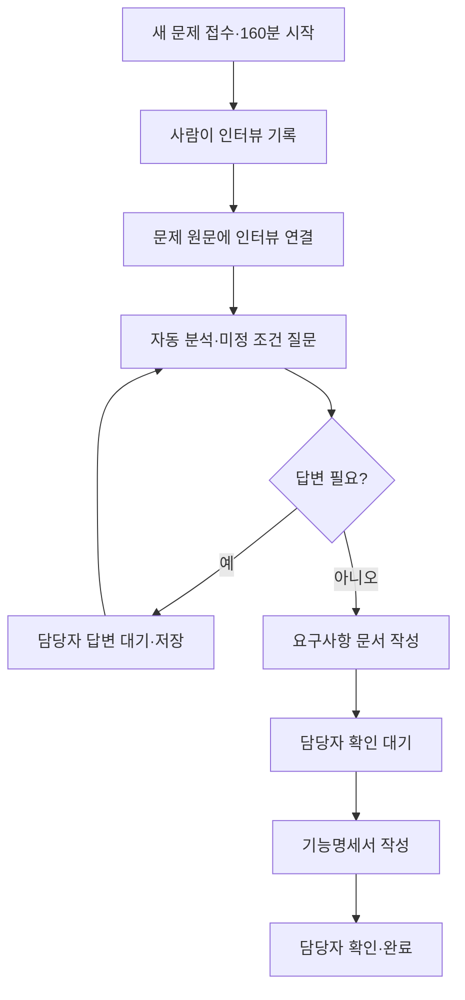

# 인터뷰 뒤에 요구사항·기능명세서 작성하기

이 안내의 `requirements` 명령은 문제 접수 시 시간을 기록하고, 사람이 작성한 인터뷰와 문제 원문을 읽어 요구사항을 정리합니다. 입력 CSV의 이상값 후보는 Python이 검사하고, 요구사항·담당자 답변의 누락과 모순은 분석 모델이 검토해 질문합니다. 담당자의 확인을 받은 다음 기능명세서를 작성하며, 기능명세서 확인으로 문서 단계를 마칩니다. 이후 구현·검토·Docker까지 진행하는 방법은 [README](../README.md)를 참고하세요.



## ZIP의 구성

```text
codex_agent_harness_python39_160min/
  run_harness.py       # 문서·개발 공통 진입점
  harness-kit/         # 공통 하네스 코드
  problem-project/    # 문제 원문·인터뷰·생성 문서·실행 상태
    config.json
    SPEC.md
    INTERVIEW.md
  answers/            # 담당자에게 받은 답변과 반환 문서
```

키트와 문제 폴더가 분리되어 있고, `answers`도 문제 폴더 밖에 있습니다. 별도 이상치 탐지 프로그램이나 탐지용 CLI는 포함하지 않습니다. 필요한 데이터 검사를 하네스 내부에서 수행합니다.

## 준비와 실행

이 배포판의 안내 기준은 Python **3.9.x**와 로그인된 Codex CLI입니다. 문서 단계에는 추가 Python 패키지나 tmux가 필요하지 않습니다. 아래 명령은 ZIP을 푼 최상위 폴더에서 실행합니다. `py -3.9`를 사용할 수 없다면 설치된 Python 3.9의 실행 경로 또는 활성화한 3.9 가상환경의 `python`으로 바꾸세요. OneDrive 등 자동 동기화 폴더 대신 일반 로컬 폴더를 사용하세요.

1. `problem-project/config.json`의 공통 `model`은 `gpt-6.1-sol`입니다. 이 안내의 질문·요구사항·기능명세서 작성은 공통값을 사용합니다. 이후 개발 단계의 독립 검토에는 이미 설정된 `reviewer_model: gpt-5.6-terra`가 우선합니다. 다른 모델을 사용하려면 문서 분석 전에 설정을 바꾸세요. 명령의 `--model "사용할 모델 ID"`는 공통값만 바꾸고 검토 전용 값은 유지합니다. `spec`은 `SPEC.md`, `interview`는 `INTERVIEW.md`로 둡니다. 개인 로그인 정보나 API 키는 ZIP에 포함하지 않습니다.
2. **문제를 받자마자**, 인터뷰 전에 시계를 시작합니다. 이 단계에는 `SPEC.md`가 아직 없어도 됩니다.

```text
py -3.9 run_harness.py start
py -3.9 run_harness.py time-status
```

이미 접수한 문제라면 최초 시작 때 실제 시각을 지정합니다.

```text
py -3.9 run_harness.py start --received-at "2026-11-05T10:55:00+09:00"
```

새 과제의 기본 제한은 160분(9600초)이며 인터뷰와 담당자 응답·확인 대기도 포함됩니다. 다시 실행해도 최초 시각은 바뀌지 않습니다. 이미 9000초로 시작한 과제는 저장된 150분 마감을 그대로 유지하므로, 진행 중인 시간 설정이나 기록을 바꾸지 마세요. 만료 후에는 결과를 보존하며 생성·확인을 중단합니다.

3. 사람이 인터뷰를 진행하고 `problem-project/INTERVIEW.md`에 기록합니다. 실제 답변, 자료에서 확인한 사실, 성공 기준, AI 제안·가정, 미정 사항을 구분합니다. 빈칸이나 '미정'은 동의한 조건이 아닙니다. AI가 만든 제안을 실제 답변 칸에 옮기지 마세요. 문서 확인 중 받은 수정 요청은 6절에 기록합니다.
4. `problem-project/SPEC.md`에 받은 문제 원문을 그대로 넣고, 제공된 `INTERVIEW.md` 참조 문구를 유지합니다. 관련 자료도 `problem-project` 안에 저장해 상대 경로로 연결합니다.
5. 입력 데이터도 확인하려면 CSV를 `problem-project` 안에 저장하고, `config.json`의 `data_files`에 상대 경로를 적습니다. 예: `"data_files": ["data/measurements.csv"]`. 목록이 비어 있으면 데이터 검사를 생략하고 문서를 분석합니다. CSV도 `SPEC.md`의 함께 읽을 자료에 적어 두세요.
6. 요구사항 분석을 실행합니다.

```text
py -3.9 run_harness.py requirements
```

설정한 CSV의 검사 요약과 원문·인터뷰·실제 답변을 함께 분석합니다. 이상값 후보의 처리, 단위·기준의 누락, 서로 충돌하는 규칙 등 확인이 필요한 내용을 질문합니다. 이미 실제 답변으로 해결한 내용은 다시 묻지 않도록 합니다. 질문이 생기면 화면과 `problem-project/BOUNDARY_ANSWERS.md`에 표시하고 멈춥니다. 담당자에게 받은 답변을 UTF-8로 `answers/Q-001.txt` 등에 저장해 제출합니다.

```text
py -3.9 run_harness.py requirements --answer Q-001 --answer-file answers/Q-001.txt
```

남은 질문에 모두 답하면 자동으로 다시 분석합니다. 진행을 막는 미정 사항이 없으면 `problem-project/CONFIRMED_REQUIREMENTS.md`를 작성하고 확인을 기다립니다. 특정 조건을 미정으로 두고 진행하라는 담당자의 명시적인 실제 답변이 있으면 그 조건은 문서의 '미결 사항'으로 남깁니다. 단순히 모른다는 답변은 진행 동의가 아닙니다. 질문이 없으면 바로 문서를 작성합니다.

7. 요구사항 문서를 담당자에게 보내 확인받습니다. 반환받은 같은 파일을 `answers/confirmed.md`에 저장해 등록합니다.

```text
py -3.9 run_harness.py requirements --confirm-file answers/confirmed.md
```

확인을 등록한 다음 **기능명세서 작성 모델을 호출**하고 `problem-project/FUNCTIONAL_SPEC.md`를 생성합니다. 다시 확인을 기다립니다.

8. 기능명세서도 확인받고 반환 문서를 등록하면 완료합니다.

```text
py -3.9 run_harness.py requirements --confirm-functional answers/functional-confirmed.md
```

두 확인 단계 모두 생성본과 반환 문서의 바이트가 같아야 합니다. 줄바꿈·인코딩만 달라져도 거부합니다. 확인 전 생성 파일을 직접 고치지 마세요. 수정 요청은 인터뷰의 실제 답변이나 문제 원문에 반영하고 다시 분석해 새 문서를 확인받습니다.

```text
py -3.9 run_harness.py requirements --status
```

상태 조회는 모델을 호출하지 않습니다. 종료 코드 `3`은 질문·확인 대기, `0`은 완료 또는 조회 성공, `2`는 오류·마감 만료, `130`은 사용자 중단입니다.

## 인터뷰 반영과 복구

- `config.json`에서 지정한 인터뷰는 필수 입력입니다. 원문에서 연결하지 않았거나, 파일이 없거나, 분석 모델이 참조 목록에서 누락하면 진행을 거부합니다.
- 생성 문서의 '입력 출처'와 상태의 `input_hashes`에 인터뷰가 포함됩니다. 인터뷰가 바뀌면 이전 요구사항·기능명세서 확인을 재사용하지 않습니다.
- 설정한 데이터 파일도 입력 해시에 묶습니다. CSV가 바뀌면 예전 검사 요약과 문서 확인을 재사용하지 않습니다. 데이터는 자동 삭제·보정하지 않습니다.
- 프롬프트에서도 AI 제안, 가정, 미정 목표를 합의된 요구사항으로 채택하지 않도록 구분합니다. 모델의 업무 판단을 보장하는 검사는 아니므로 담당자 확인은 필요합니다.
- 실제 추가 답변은 명령으로 등록합니다. `problem-project/.harness/boundary.json`, `problem-project/BOUNDARY_ANSWERS.md`와 생성 문서를 직접 편집하지 않습니다.
- 중단되면 `problem-project/.harness/work`와 시간 기록을 보존하고 같은 명령으로 재개합니다. 정상 완료 기록과 입력이 유지되고 제한 시간이 남아 있으면 완료된 호출의 결과를 재사용합니다. 실행 여부가 불확실하거나 파일이 예기치 않게 바뀌면 덮어쓰지 않고 중단합니다.
- 생성 준비 중 `--model`이나 `--timeout`을 별도로 지정했다면 재개할 때도 같은 값으로 실행합니다.
- 실패 종료와 프로세스 정리가 확인된 문서 생성은 다음 실행에서 새 리비전으로 재시도합니다. 종료나 정리가 불확실한 실행은 차단하고 기록을 보존합니다. 상태 파일·실행 폴더 삭제로 우회하지 마세요.
- 모델이 실행되는 동안 `problem-project` 안 파일을 저장하지 마세요. 편집·동기화로 입력이 바뀌면 생성 결과를 채택하지 않고 중단합니다.

## 기존 안내와 달라진 점

문서 단계는 준비된 폴더와 단일 Python 진입점을 사용하며 설치기·`attach`·Git·tmux가 필요하지 않습니다. 이 안내의 `requirements` 명령은 기능명세서 확인까지만 진행합니다. 개발까지 이어가려면 README의 `run` 또는 `develop` 안내를 따르세요. 개발 계획 승인 뒤 첫 테스트 작성 전에 준비 점검하며, 새 승인 단계를 추가하지 않습니다.

다른 문제 폴더를 사용하려면 하네스 밖에 설정·문제·인터뷰·질문 템플릿을 준비하고 각 명령에 `--root`를 지정합니다. 한 프로젝트 폴더는 한 문제에 사용합니다.

## 도구 자체 검사

```text
py -3.9 -B -m unittest discover -s harness-kit/.harness/tests
```

검사는 로컬 모의 모델을 사용합니다. 실제 모델 응답 품질이나 현장 이상치 탐지 성능 검증을 뜻하지 않습니다. 수치 이상 후보가 실제 오류인지, 문서의 모순이 해소됐는지는 담당자가 확인합니다. 현재 배포본의 검사 결과는 `validation/REPORT.md`에 기록합니다.
